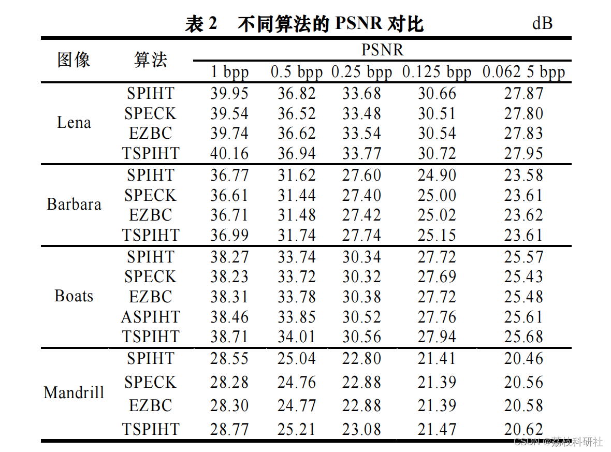
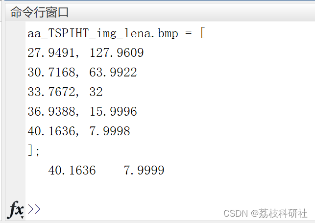
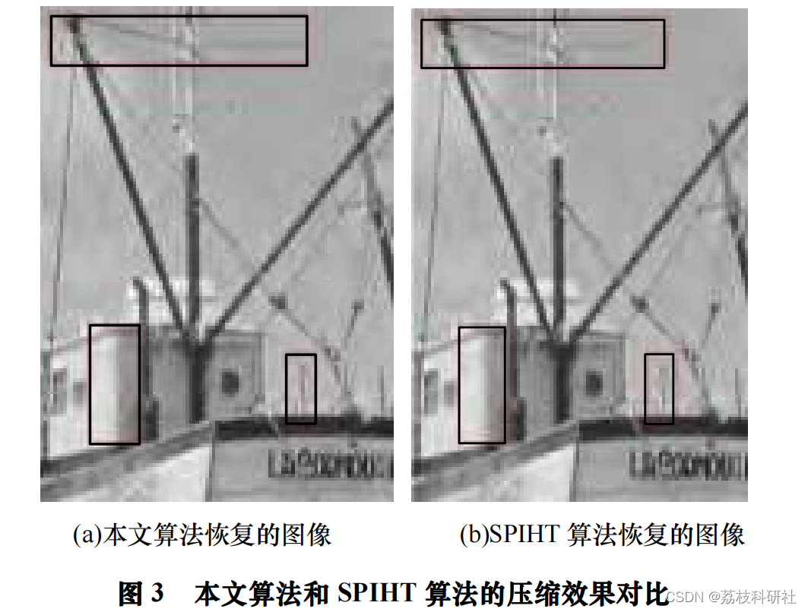

# Improved SPIHT algorithm based on binary tree (Matlab code implementation)

​  
Editor
With the increasing amount of information in modern society that needs to be stored and transmitted, compression is often applied. People not only desire high compression ratios from compression algorithms but also wish for fast execution speeds. Wavelet transforms have excellent time-frequency localized expression capabilities and multiresolution analysis characteristics, along with fast decomposition and reconstruction algorithms, which have been widely applied in the field of image coding.
[1] Embedded Zerotree Wavelet (EZW) is an image compression algorithm based on wavelet transform. It constructs a zero tree by spatial similarity of different scaled wavelet coefficients at each bit plane, thereby successfully predicting a large number of non-important coefficients with a single root of the zero tree, achieving better compression results than JPEG based on discrete cosine transform. The Set Partitioning in Hierarchical Trees (SPIHT) algorithm [2] makes significant improvements to the EZW algorithm, featuring higher compression efficiency and faster execution speed among other advantages, making it currently one of the superior algorithms for compression algorithms based on zero tree structures.
The partitioning Embedded block) algorithm [4] accelerates the computation speed and further utilizes the relationship between adjacent coefficient blocks within sub-bands.
To achieve better compression effects, almost all algorithms in the above documents require lossless compression (entropy encoding) to improve algorithm efficiency. However, entropy encoding requires significant computational effort. If arithmetic coding is used in the SPIHT algorithm, the encoding time will be more than double [2]. To improve compression while maintaining the speed of the SPIHT algorithm, this paper proposes a new fast coding algorithm based on SPIHT and binary tree. This algorithm differs from the aforementioned literature, although Literature [9] proposed a binary tree image coding method based on lifting wavelets, which is similar to the directional tree structure of SPIHT in cross-scale zero trees. However, the binary tree in this algorithm is established on adjacent coefficients at the same scale.📚2 Running results​edit
​edit
​edit
Part of the code:  
clc;clear;  
%----------- Input ----------------  
global level carow row  
imname = 'img_lena.bmp';  
Orig_I=double(imread(imname));  
[row, col] = size(Orig_I);  
% Maximum bit rate  
rate = 1;  
max_bits = floor(rate * row^2);  
% 5 bit rates for encoding length [128:1, 64:1, 32:1, 16:1, 8:1]  
brates = floor([0.0625, 0.125, 0.25, 0.5, 1]*row*row);  
%----------- Wavelet Decomposition ----------------  
n = size(Orig_I,1);
n_log = log2(n);  
level = floor(n_log);  
% level = 3;  
carow = 2^(n_log-level);  
I_W = wavecdf97(Orig_I, level);  
n_max = floor(log2(abs(max(max(I_W)')))); % Initial threshold T=2^n_max
% =========================================================================  
% Coding  
[out_head,out_code,out_type,pixFlag] = func_SPIHT_Enc(I_W, max_bits, level);  
l2 = find(out_code==2); out_code(l2)=[];  
l2 = find(out_type=='O'); out_type(l2)=[];  
% =========================================================================  
% Decoding  
disp(['aa_TSPIHT_' imname ' = [']);  
img_dec = func_SPIHT_Dec(out_head,out_code,brates,Orig_I);  
disp('];');  
img_spiht = wavecdf97(img_dec, -level);  
Q = 255;  
MSE = sum(sum((img_spiht - Orig_I) .^ 2)) / row / col;  
psnr = 10*log10(Q*Q/MSE);  
rate = numel(Orig_I)*8/length(out_code);  
disp([psnr,rate]);  
clc;clear;  
%----------- Input ----------------  
global level carow row  
imname = 'img_lena.bmp';  
Orig_I=double(imread(imname));  
[row, col] = size(Orig_I);  
% Maximum bitrate
rate = 1;  
max_bits = floor(rate * row^2);  
% Encoding length at a bitrate of 5 [128:1, 64:1, 32:1, 16:1, 8:1]
brates = floor([0.0625, 0.125, 0.25, 0.5, 1]*row*row);  
%----------- Wavelet Decomposition ----------------  
n = size(Orig_I,1);  
n_log = log2(n);  
level = floor(n_log);  
% level = 3;  
carow = 2^(n_log-level);  
I_W = wavecdf97(Orig_I, level);  
n_max = floor(log2(abs(max(max(I_W)')))); % Initial threshold T=2^n_max
% =========================================================================  
% Coding  
[out_head,out_code,out_type,pixFlag] = func_SPIHT_Enc(I_W, max_bits, level);  
l2 = find(out_code==2); out_code(l2)=[];  
l2 = find(out_type=='O'); out_type(l2)=[];  
% =========================================================================  
% Decoding  
disp(['aa_TSPIHT_' imname ' = [']);  
img_dec = func_SPIHT_Dec(out_head,out_code,brates,Orig_I);  
disp('];');  
img_spiht = wavecdf97(img_dec, -level);  
Q = 255;  
MSE = sum(sum((img_spiht - Orig_I) .^ 2)) / row / col;  
psnr = 10*log10(Q*Q/MSE);  
rate = numel(Orig_I)*8/length(out_code);  
disp([psnr,rate]); 
🌈3 Matlab code implementation 
🎉4 References

## Images

<!-- PAYMENT_BLOCK -->

## Get this dataset

- Payment link (Stripe): [Buy now](https://buy.stripe.com/3cs8yP7sY87d0vu9AB)
- Payment QR code: 

<!-- /PAYMENT_BLOCK -->
